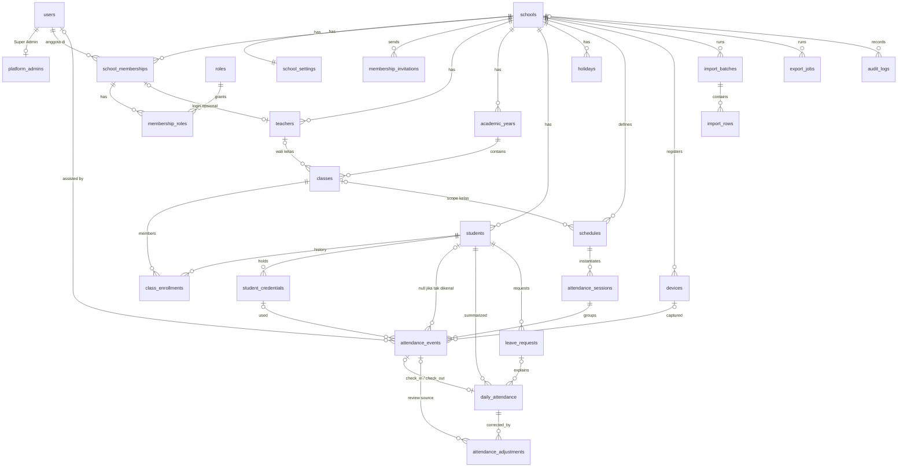

# DATABASE DESIGN — Sentra Sekolah

**Status:** Draf tahap 1 — menunggu tinjauan
**DBMS:** PostgreSQL 17/18. Ekstensi: `citext`, `pg_trgm`, `btree_gist`
**Acuan:** PRD bagian 7 dan 11.3. Nama tabel mengikuti PRD. Penambahan dan perubahan diberi tanda **[+]** atau **[Δ]** beserta alasannya.

---

## 1. Konvensi

| Aturan | Detail |
|---|---|
| Primary key | `uuid` (UUIDv7, berurutan waktu, dibangkitkan aplikasi) |
| Tenant | Setiap tabel milik sekolah memiliki `school_id uuid NOT NULL` + `UNIQUE (school_id, id)` sebagai target FK komposit |
| FK lintas entitas tenant | **Komposit** `(school_id, x_id) → parent(school_id, id)`. Mustahil menautkan data dua sekolah. |
| Waktu | `timestamptz` (disimpan UTC). Tanggal absensi adalah `date` lokal sekolah, dihitung server saat transaksi. Jam jadwal adalah `time` lokal. |
| Enum | `text` + `CHECK (... IN (...))`, bukan tipe ENUM PostgreSQL (lebih mudah dimigrasi) |
| Penghapusan | Data inti tidak di-hard-delete. Memakai `status`/`ended_at`. Event & audit append-only. |
| Penamaan | snake_case, jamak untuk tabel |
| Timestamps | `created_at`, `updated_at timestamptz NOT NULL DEFAULT now()` |
| RLS | Aktif pada semua tabel ber-`school_id` (lihat §6) |

---

## 2. ERD



---

## 3. Definisi Tabel

### 3.1 Tenancy & identitas

#### `schools`
| Kolom | Tipe | Catatan |
|---|---|---|
| id | uuid PK | |
| code | citext UNIQUE NOT NULL | kode internal platform |
| npsn | text UNIQUE NULL | [+] Nomor Pokok Sekolah Nasional, opsional |
| name | text NOT NULL | |
| education_levels | text[] NOT NULL | `CHECK (education_levels <@ ARRAY['SD','MI','SMP','MTs','SMA','SMK','MA','lainnya'])` [TERBUKA: daftar final] |
| timezone | text NOT NULL | `CHECK IN ('Asia/Jakarta','Asia/Makassar','Asia/Jayapura')` [PRD 5.1] |
| address | text NULL | |
| status | text NOT NULL | `trial`, `active`, `suspended`, `terminated` |
| created_at, updated_at | timestamptz | |

Tabel ini **tidak** memakai RLS tenant. Akses dibatasi oleh aplikasi: Super Admin untuk semua baris, user sekolah hanya baris sekolahnya.

#### `school_settings` [+]
Pengaturan bertipe (bukan JSON bebas) agar tervalidasi dan teraudit.

| Kolom | Tipe | Default |
|---|---|---|
| school_id | uuid PK FK→schools | |
| terminal_show_photo | boolean | false |
| min_rescan_gap_minutes | smallint | 5 (`CHECK 1..120`) |
| allow_qr / allow_rfid | boolean | true / false |
| assisted_mode_enabled | boolean | true |
| checkout_without_checkin_policy | text | `needs_review` [TERBUKA D-10] |
| late_minutes_basis | text | `after_deadline` (`after_deadline`, `after_grace`) [TERBUKA D-29] |
| attendance_rate_formula | text | `exclude_approved_leave` [TERBUKA D-14] |
| updated_at, updated_by_user_id | | |

#### Identitas & keanggotaan [Δ ADR 0004]
PRD §7.1 menaruh `school_id` di `users`. Atas keputusan pemilik produk, identitas dipisahkan dari keanggotaan sekolah agar satu akun dapat mengakses beberapa sekolah. Definisi rinci kolom dan constraint ada di [`TAHAP_1_FONDASI.md` §2](TAHAP_1_FONDASI.md).

| Tabel | Fungsi | RLS |
|---|---|---|
| `users` | Identitas global: email (citext, unik global), nama, password, 2FA, status platform. **Tanpa `school_id`.** | Tidak |
| `platform_admins` | Penanda Super Admin | Tidak |
| `school_memberships` | User ↔ sekolah, status `active/suspended/ended`; `UNIQUE (school_id, user_id)`, `UNIQUE (school_id, id)` | Ya (baca: konteks sekolah atau user sendiri) |
| `roles` | Seed: `school_admin`, `principal`, `homeroom_teacher`, `duty_officer`, `terminal_operator` | Tidak |
| `membership_roles` | Peran per keanggotaan; FK komposit `(school_id, membership_id)` | Ya |
| `membership_invitations` | Undangan email, hanya hash token yang disimpan | Ya |

Kolom pelaku di tabel lain (`created_by_user_id`, `approved_by_user_id`, dst.) tetap merujuk `users.id`. Validasi bahwa pelaku adalah anggota sekolah dilakukan oleh aplikasi saat aksi terjadi.

#### `teachers` [+] [TERBUKA D-07]
PRD meminta CRUD "guru", tetapi tidak semua guru membutuhkan akun.
| Kolom | Tipe | Catatan |
|---|---|---|
| id, school_id | | |
| membership_id | uuid NULL | FK komposit `(school_id, membership_id)` ke `school_memberships`; `UNIQUE (membership_id)` |
| full_name | text NOT NULL | |
| employee_number | text NULL | NIP/NUPTK; `UNIQUE (school_id, employee_number) WHERE employee_number IS NOT NULL` |
| status | text | `active`, `inactive` |

### 3.2 Akademik

#### `academic_years`
`id, school_id, name, start_date, end_date, is_active`
- `CHECK (end_date > start_date)`
- `UNIQUE (school_id) WHERE is_active` (maksimal satu tahun ajaran aktif)
- `EXCLUDE USING gist (school_id WITH =, daterange(start_date, end_date, '[]') WITH &&)` (tidak boleh tumpang tindih)

#### `classes` (rombongan belajar)
`id, school_id, academic_year_id, name, grade_level smallint, homeroom_teacher_id NULL, status, timestamps`
- `CHECK (grade_level BETWEEN 1 AND 13)`
- `UNIQUE (school_id, academic_year_id, name)`
- FK komposit ke `academic_years` dan `teachers`
- [Δ] PRD memakai `homeroom_teacher_user_id`; diusulkan `homeroom_teacher_id → teachers` (lihat D-07).

#### `students`
| Kolom | Tipe | Catatan |
|---|---|---|
| id, school_id | | |
| student_number | text NOT NULL | NIS; `UNIQUE (school_id, student_number)` [PRD 7.1] |
| nisn | text NULL | `UNIQUE (school_id, nisn) WHERE nisn IS NOT NULL`; `CHECK (nisn ~ '^[0-9]{10}$')` |
| full_name | text NOT NULL | indeks GIN `pg_trgm` untuk pencarian |
| photo_object_key | text NULL | object storage privat |
| date_of_birth | date NULL | hanya jika diperlukan |
| status | text NOT NULL | `active`, `inactive`, `graduated`, `transferred` |
| status_changed_at | timestamptz NULL | |
| timestamps | | |

#### `class_enrollments`
`id, school_id, student_id, class_id, start_date, end_date NULL, status, created_by_user_id`
- FK komposit ke `students` dan `classes`
- `CHECK (end_date IS NULL OR end_date >= start_date)`
- `EXCLUDE USING gist (school_id WITH =, student_id WITH =, daterange(start_date, end_date, '[]') WITH &&)`: siswa tidak bisa berada di dua kelas pada tanggal yang sama
- Pindah kelas = menutup enrollment lama + membuat yang baru, dalam satu transaksi. Riwayat absensi tidak tersentuh [PRD 7.1].

### 3.3 Kalender & jadwal

#### `holidays` [+]
`id, school_id, name, start_date, end_date, created_by_user_id, timestamps`, `CHECK (end_date >= start_date)`.
MVP berlaku untuk seluruh sekolah. Libur per jenjang/kelas: [TERBUKA D-24].

#### `schedules`
| Kolom | Tipe | Catatan |
|---|---|---|
| id, school_id | | |
| scope_type | text | `school`, `grade_level`, `class` |
| grade_level | smallint NULL | wajib jika scope `grade_level` |
| class_id | uuid NULL | wajib jika scope `class` (FK komposit) |
| scope_key | text GENERATED ALWAYS | `'school'` \| `'grade:'||grade_level` \| `'class:'||class_id`. Dibutuhkan agar exclusion constraint berlaku walau ada NULL. |
| day_of_week | smallint | ISO 1=Senin … 7=Minggu |
| check_in_start | time | |
| check_in_deadline | time | |
| late_grace_minutes | smallint | `>= 0` |
| check_out_start | time | |
| scheduled_check_out | time | |
| effective_from | date NOT NULL | |
| effective_until | date NULL | |
| is_active | boolean | |
| created_by_user_id | uuid | |

Constraint:
- Konsistensi scope: `CHECK` sesuai `scope_type`.
- Urutan waktu: `check_in_start < check_in_deadline AND check_in_deadline < check_out_start AND check_out_start <= scheduled_check_out`. Jadwal yang melewati tengah malam **tidak didukung** di MVP.
- `EXCLUDE USING gist (school_id WITH =, scope_key WITH =, day_of_week WITH =, daterange(effective_from, effective_until, '[]') WITH &&) WHERE (is_active)`
- **Imutabilitas:** jadwal yang sudah dirujuk `attendance_sessions` tidak boleh diubah jamnya (trigger). Perubahan dibuat sebagai versi baru dengan `effective_from` baru, dan versi lama ditutup `effective_until` [PRD 5.1].

Resolusi jadwal siswa pada tanggal D: hari libur → tidak ada sesi. Selain itu urutan prioritas: jadwal `class` > `grade_level` > `school` yang aktif dan efektif pada D untuk `day_of_week(D)`. Jadwal "kelompok siswa" [PRD 5.1] dan jadwal khusus per tanggal: [TERBUKA D-24].

### 3.4 Kredensial & perangkat

#### `student_credentials`
| Kolom | Tipe | Catatan |
|---|---|---|
| id, school_id, student_id | | FK komposit |
| credential_type | text | `qr`, `rfid` |
| value_hash | bytea NOT NULL | HMAC-SHA256(nilai ternormalisasi, `CREDENTIAL_HMAC_KEY`) |
| hash_key_version | smallint NOT NULL | untuk rotasi kunci |
| value_hint | text NULL | mis. 4 karakter terakhir UID untuk identifikasi kartu oleh admin; QR: NULL |
| reader_profile | text NULL | profil normalisasi UID (RFID) |
| status | text | `active`, `blocked`, `revoked` |
| status_reason | text NULL | |
| issued_at, blocked_at, revoked_at | timestamptz | |
| replaces_credential_id | uuid NULL | rantai penggantian kartu |
| created_by_user_id | uuid | |

Constraint:
- `UNIQUE (school_id, credential_type, value_hash) WHERE status <> 'revoked'`: kartu yang diblokir tetap dikenali agar terminal bisa menampilkan "Kredensial diblokir"
- `UNIQUE (school_id, student_id, credential_type) WHERE status = 'active'`: satu QR aktif dan satu RFID aktif per siswa [TERBUKA D-17]
- QR: token 128-bit acak, format `SA1.<base32>`. **Hanya hash yang disimpan**, sehingga cetak ulang berarti terbit ulang dan kartu lama tidak berlaku lagi [TERBUKA D-16].
- Status hanya bergerak maju: `active ⇄ blocked → revoked`. Tidak ada penghapusan; riwayat tetap ada [PRD 12.C].

#### `devices`
| Kolom | Tipe | Catatan |
|---|---|---|
| id, school_id | | |
| name | text | |
| device_type | text | `gate_terminal` |
| status | text | `pending_pairing`, `active`, `revoked` |
| token_hash | bytea NULL UNIQUE | SHA-256 token device |
| pairing_code_hash | bytea NULL | |
| pairing_expires_at | timestamptz NULL | |
| paired_at, last_seen_at, revoked_at | timestamptz NULL | |
| last_seen_ip | inet NULL | mengikuti kebijakan retensi |
| reader_profile | text NULL | profil normalisasi RFID untuk reader yang terpasang |
| created_by_user_id | uuid | |

[Δ] `device_identifier` di PRD digantikan oleh token hasil pairing; identifier perangkat keras dari browser tidak dapat diandalkan.

### 3.5 Absensi

#### `attendance_sessions`
`id, school_id, session_date date, schedule_id, timezone text (snapshot), status, closed_at, timestamps`
- `status`: `open`, `closed` (penutupan hari sudah mematerialisasi `belum_tercatat`), `finalized` (alpa sudah dikonfirmasi)
- `UNIQUE (school_id, session_date, schedule_id)`
- Dibuat secara lazy (scan pertama) atau oleh job penutupan hari.
- MVP: **satu sesi per siswa per hari** (shift pagi/siang ditangani lewat jadwal per kelas). Multi-sesi per siswa per hari: [TERBUKA D-11b], akan mengubah unique key `daily_attendance`.

#### `attendance_events` (append-only)
| Kolom | Tipe | Catatan |
|---|---|---|
| id | uuid PK | |
| school_id | uuid NOT NULL | |
| student_id | uuid NULL | NULL bila kredensial tidak dikenal |
| credential_id | uuid NULL | |
| attendance_session_id | uuid NULL | |
| attendance_date | date NULL | [+] tanggal lokal, dibutuhkan untuk unique index |
| event_type | text NULL | `check_in`, `check_out`; NULL bila ditolak sebelum ditentukan |
| method | text NOT NULL | `qr`, `rfid`, `assisted_manual`. `face` **tidak diizinkan** sampai Tahap 7. |
| result | text NOT NULL | `accepted`, `duplicate`, `rejected`, `needs_review` |
| reason_code | text NULL | kode stabil, mis. `UNKNOWN_CREDENTIAL`, `ALREADY_CHECKED_IN` |
| occurred_at_server | timestamptz NOT NULL | dari Clock server [PRD 5.1] |
| client_captured_at | timestamptz NULL | diagnostik saja, tidak pernah dipakai untuk status |
| device_id | uuid NULL | |
| created_by_user_id | uuid NULL | petugas (mode bantuan) |
| assist_reason_code | text NULL | |
| assist_note | text NULL | |
| is_late | boolean NULL | |
| late_minutes | integer NULL | |
| is_early_leave | boolean NULL | |
| idempotency_key | uuid NOT NULL | |
| credential_fingerprint | bytea NULL | HMAC terpotong untuk input tak dikenal (diagnosa kartu berulang) tanpa menyimpan nilai mentah |
| response_snapshot | jsonb NOT NULL | respons yang dikembalikan, untuk replay idempotensi. Tanpa PII selain yang sudah tampil di layar. |
| metadata | jsonb NULL | terbatas, non-sensitif |
| created_at | timestamptz | |

Constraint & indeks:
- `UNIQUE (school_id, idempotency_key)` [PRD 4.6, 7.2]
- `UNIQUE (school_id, student_id, attendance_date, event_type) WHERE result = 'accepted'`: **jaring pengaman utama terhadap kehadiran ganda**
- `CHECK (result <> 'accepted' OR (student_id IS NOT NULL AND event_type IS NOT NULL AND attendance_session_id IS NOT NULL AND attendance_date IS NOT NULL))`
- `CHECK (method <> 'assisted_manual' OR (created_by_user_id IS NOT NULL AND assist_reason_code IS NOT NULL))`
- `CHECK (method IN ('qr','rfid','assisted_manual'))`
- Trigger menolak `UPDATE`/`DELETE`; role aplikasi hanya mendapat `INSERT, SELECT`
- Indeks: `(school_id, occurred_at_server DESC)`, `(school_id, student_id, attendance_date)`, `(school_id, result, occurred_at_server) WHERE result <> 'accepted'`
- Partisi (masa depan): range per `attendance_date` agar unique index tetap valid. Semua unique key nantinya harus memuat kolom partisi, jadi perlu dirancang ulang saat itu [PRD 11.3].

#### `daily_attendance` (proyeksi)
| Kolom | Tipe | Catatan |
|---|---|---|
| id, school_id, student_id | | |
| attendance_date | date NOT NULL | |
| attendance_session_id | uuid NULL | |
| class_id | uuid NULL | [+] snapshot kelas pada tanggal itu, agar laporan per kelas tetap benar setelah siswa pindah |
| attendance_status | text NOT NULL | `belum_tercatat`, `hadir`, `terlambat`, `izin`, `sakit`, `dispensasi`, `alpa_belum_diverifikasi`, `alpa` (ADR 0005 §5) |
| check_in_event_id | uuid NULL | FK komposit ke event |
| check_out_event_id | uuid NULL | |
| late_minutes | integer NULL | |
| early_leave | boolean NOT NULL DEFAULT false | [Δ] "Pulang awal" sebagai atribut [TERBUKA D-08] |
| early_leave_status | text NULL | `pending`, `approved`, `rejected` |
| leave_request_id | uuid NULL | |
| source | text | `automatic`, `manual_adjustment` |
| last_adjustment_id | uuid NULL | |
| approved_by_user_id | uuid NULL | |
| adjustment_reason | text NULL | ringkasan; histori lengkap di `attendance_adjustments` |
| finalized_at, finalized_by_user_id | | |
| version | integer NOT NULL DEFAULT 1 | optimistic locking untuk edit dari dashboard |
| created_at, updated_at | | |

- `UNIQUE (school_id, student_id, attendance_date)` [PRD 7.1]
- [Δ ADR 0005 §5, D-33 diputuskan] Kolom tambahan `absence_basis` (`rule`, `manual`), `verified_by_user_id`, `verified_at`.
  - `CHECK (attendance_status <> 'alpa' OR (verified_by_user_id IS NOT NULL AND verified_at IS NOT NULL))`: alpa final selalu terverifikasi manusia.
  - `CHECK (attendance_status NOT IN ('alpa','alpa_belum_diverifikasi') OR absence_basis IS NOT NULL)`.
- [+] Tabel `attendance_day_health` (`school_id, attendance_date, status ok|perlu_pemeriksaan|dilepas, reasons jsonb, evaluated_at, released_by_user_id, release_reason`), `UNIQUE (school_id, attendance_date)`. Menahan aturan alpa saat ada gangguan (ADR 0005 §5).
- `CHECK (attendance_status NOT IN ('hadir','terlambat') OR check_in_event_id IS NOT NULL OR source = 'manual_adjustment')`
- Indeks: `(school_id, attendance_date)`, `(school_id, class_id, attendance_date)`, `(school_id, attendance_status, attendance_date)`

#### `attendance_adjustments` [+] (append-only)
Histori koreksi terstruktur untuk "Laporan koreksi manual" [PRD 10] dan alur pengajuan oleh wali kelas [PRD 2.1].
| Kolom | Tipe |
|---|---|
| id, school_id, daily_attendance_id, student_id, attendance_date | |
| source_event_id | uuid NULL (bila hasil resolusi `needs_review`) |
| adjustment_type | `status_change`, `check_in_time`, `check_out_time`, `early_leave_decision`, `review_resolution` |
| from_value, to_value | jsonb (tersaring) |
| reason | text NOT NULL, `CHECK (length(trim(reason)) >= 10)` |
| status | `pending`, `approved`, `rejected` |
| requested_by_user_id | NOT NULL |
| decided_by_user_id, decided_at | NULL |
| created_at | |

Koreksi waktu **tidak mengubah event**. Nilai yang dikoreksi disimpan di sini dan proyeksi harian menampilkan nilai koreksi beserta penandanya [PRD 8.3].

#### `leave_requests`
Sesuai PRD 7.1. `leave_type IN ('izin','sakit','dispensasi')`, `CHECK (end_date >= start_date)`, `attachment_object_key` privat. Persetujuan memicu perhitungan ulang `daily_attendance` untuk rentang tanggal tersebut (dalam transaksi yang sama).

### 3.6 Impor, ekspor, audit

#### `import_batches` [+] / `import_rows` [+]
- `import_batches`: `id, school_id, type ('students'), status ('uploaded','validating','validated','committing','committed','failed','cancelled'), original_filename, object_key, file_sha256, total_rows, valid_rows, invalid_rows, committed_rows, uploaded_by_user_id, committed_by_user_id, timestamps`
- `import_rows`: `id, school_id, batch_id, row_number, payload jsonb, normalized jsonb, status ('valid','invalid','committed','skipped'), errors jsonb`
- Data staging dihapus terjadwal (mis. 30 hari) [TERBUKA D-26]

#### `export_jobs` [+]
`id, school_id, requested_by_user_id, report_type, filters jsonb, format, status, object_key, row_count, expires_at, error, timestamps`

#### `audit_logs` (append-only)
| Kolom | Tipe |
|---|---|
| id | uuid PK |
| school_id | uuid NULL |
| actor_type | `user`, `device`, `system` |
| actor_user_id, actor_device_id | uuid NULL |
| action | text, mis. `attendance.adjustment.approved` |
| entity_type, entity_id | |
| reason | text NULL |
| before_value, after_value | jsonb (allowlist) |
| ip_address | inet NULL |
| user_agent | text NULL |
| request_id | text |
| created_at | timestamptz |

Indeks `(school_id, created_at DESC)`, `(school_id, entity_type, entity_id)`. Trigger anti `UPDATE/DELETE`. RLS: baris `school_id IS NULL` hanya terlihat oleh konteks platform.

### 3.7 Ditunda (tidak dibuat di MVP)
| Tabel | Alasan |
|---|---|
| `guardians`, `student_guardians`, `notifications` | Portal orang tua di luar MVP [PRD 1.2]. Menambahkannya nanti bersifat aditif, tanpa migrasi destruktif. Membuat tabel kosong sekarang tidak memberi nilai dan menambah permukaan data pribadi. [TERBUKA D-27] |
| `biometric_profiles` | Dibuat hanya di Tahap 7 setelah gerbang kepatuhan terpenuhi [PRD 7.1, 8.2]. |

---

## 4. Aturan Integritas Kritis (ringkasan)

| Risiko | Pertahanan aplikasi | Pertahanan database |
|---|---|---|
| Kehadiran ganda (retry jaringan) | idempotency key + replay respons | `UNIQUE (school_id, idempotency_key)` |
| Kehadiran ganda (scan beruntun/konkuren) | `SELECT … FOR UPDATE` baris harian + mesin keadaan | partial unique `(student, date, event_type) WHERE accepted` |
| Data lintas sekolah | tenant scope + policy | FK komposit + RLS |
| Siswa di dua kelas sekaligus | validasi enrollment | exclusion constraint daterange |
| Jadwal tumpang tindih | validasi form | exclusion constraint per scope/hari/rentang |
| Jadwal berubah retroaktif | versi baru, bukan edit | trigger imutabilitas jadwal yang sudah dipakai |
| Event diubah/dihapus | tidak ada endpoint | trigger + `REVOKE UPDATE, DELETE` |
| Alpa otomatis | finalisasi manual | `CHECK` pada `daily_attendance` |
| Kartu yang sama dipakai dua siswa | validasi registrasi | partial unique `value_hash` |
| Audit hilang | audit dalam transaksi yang sama | append-only + grant |

---

## 5. Strategi Migrasi
- Migrasi Laravel dengan SQL eksplisit (`DB::statement`) untuk constraint khusus PostgreSQL (partial unique, exclusion, RLS, trigger, generated column). Constraint ini tidak boleh hilang hanya karena keterbatasan schema builder.
- Setiap migrasi memiliki `down()` yang diuji, **kecuali** migrasi data destruktif yang ditandai *forward-only* dan disertai rencana rollback berupa restore.
- Perubahan yang aman untuk produksi: tambah kolom nullable → backfill → tambah constraint `NOT VALID` → `VALIDATE CONSTRAINT`. Indeks besar dibuat `CONCURRENTLY` (migrasi tanpa transaksi).
- Snapshot skema (`pg_dump --schema-only`) di-commit dan dibandingkan di CI untuk mendeteksi drift.
- Dua role database: `sentra_owner` (migrasi) dan `sentra_app` (runtime: tanpa DDL, tanpa `BYPASSRLS`, tanpa `UPDATE/DELETE` pada tabel append-only).

---

## 6. Row-Level Security (rancangan)

```sql
ALTER TABLE students ENABLE ROW LEVEL SECURITY;
ALTER TABLE students FORCE ROW LEVEL SECURITY;
CREATE POLICY tenant_isolation ON students
  USING (school_id = current_setting('app.school_id', true)::uuid)
  WITH CHECK (school_id = current_setting('app.school_id', true)::uuid);
```
- Bila `app.school_id` tidak diset, `current_setting(..., true)` menghasilkan NULL dan **tidak ada baris yang terlihat** (gagal tertutup).
- Diterapkan ke semua tabel ber-`school_id` NOT NULL. `audit_logs` memakai policy khusus untuk baris platform.
- `school_memberships` dan `membership_roles` memiliki policy SELECT tambahan `user_id = current_setting('app.user_id', true)::uuid` agar user bisa melihat daftar sekolahnya sendiri (ADR 0004).
- Konteks diset per request dari `{school}` di path **setelah** keanggotaan tervalidasi, lalu di-reset saat request selesai.
- Job lintas sekolah (mis. penutupan hari) melakukan iterasi per sekolah dan menyetel konteks untuk setiap sekolah.

---

## 7. Perkiraan Volume
Contoh: 1.000 siswa × 2 event/hari × ~200 hari efektif ≈ 400 ribu event/tahun/sekolah (ditambah sebagian kecil duplikat/ditolak). Untuk 100 sekolah ≈ 40 juta baris/tahun. Volume ini masih nyaman dengan indeks yang tepat. Partisi dipertimbangkan setelah ±100 juta baris atau bila query laporan melambat.
