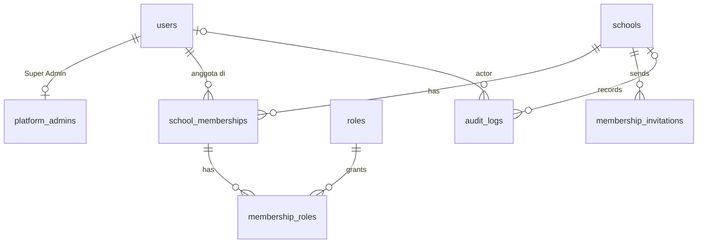

# TAHAP 1 — Fondasi: Identitas, Keanggotaan, Tenant, RBAC, Audit

**Status:** Spesifikasi (analisis) — **belum diimplementasikan**. Menunggu persetujuan.
**Acuan:** PRD §2, §3.1 (1, 2, 19, 20), §6.3, §8.1, §12.A, §14 Sprint 0; [ADR 0004](adr/0004-identitas-dan-keanggotaan-sekolah.md).

---

## 1. Ruang lingkup

**Termasuk:**
- Scaffold `apps/api` (Laravel 13) dan `apps/web` (Next.js 16).
- Login/logout, reset password mandiri, 2FA Super Admin.
- Identitas global + keanggotaan sekolah + peran per keanggotaan; undangan.
- Pemilihan sekolah lewat path, isolasi tenant berlapis (aplikasi + RLS).
- Manajemen tenant oleh Super Admin.
- Audit log append-only.
- Harness pengujian: matriks otorisasi, isolasi tenant, migrasi.
- OpenAPI + klien TypeScript.
- CI untuk API dan web.

**Tidak termasuk:** data siswa/kelas/jadwal (Tahap 2), terminal & absensi (Tahap 3+), pengaturan kehadiran sekolah.

**Prasyarat mulai:**
1. Docker Desktop terpasang dan `bash scripts/verify-dev-env.sh` lulus 100%.
2. Keputusan **D-34** (tenant lewat path) dan **D-37** (undangan & reset via email) disetujui.
3. Butir di §10 dikonfirmasi.

---

## 2. Model data Tahap 1



| Tabel | Kolom penting | Constraint utama | RLS |
|---|---|---|---|
| `schools` | id, code (citext), npsn, name, education_levels, timezone, status | `UNIQUE code`, `CHECK timezone IN (WIB/WITA/WIT)` | Tidak (akses diatur aplikasi) |
| `users` | id, email (citext), name, password, status (`active`/`disabled`), email_verified_at, two_factor_secret (terenkripsi), two_factor_confirmed_at, last_login_at | `UNIQUE email` | Tidak (identitas global; dibaca lewat keanggotaan) |
| `platform_admins` | user_id PK, created_by_user_id, created_at | FK users | Tidak (hanya rute platform) |
| `roles` | code PK, name | seed: `school_admin`, `principal`, `homeroom_teacher`, `duty_officer`, `terminal_operator` | Tidak |
| `school_memberships` | id, school_id, user_id, status (`active`/`suspended`/`ended`), status_reason, joined_at, ended_at | `UNIQUE (school_id, user_id)`, `UNIQUE (school_id, id)` | Ya: baca bila `school_id` = konteks **atau** `user_id` = user konteks; tulis hanya konteks sekolah |
| `membership_roles` | school_id, membership_id, role_code, granted_by_user_id, granted_at | PK `(membership_id, role_code)`, FK komposit `(school_id, membership_id)` | Ya (seperti di atas) |
| `membership_invitations` | id, school_id, email, role_codes text[], token_hash bytea, invited_by_user_id, expires_at, accepted_at, accepted_user_id, revoked_at | `UNIQUE token_hash`; `UNIQUE (school_id, email) WHERE accepted_at IS NULL AND revoked_at IS NULL` | Ya. Lookup token publik lewat fungsi `SECURITY DEFINER` yang hanya mengembalikan satu baris berdasarkan hash. |
| `audit_logs` | lihat DATABASE_DESIGN §3.6 + `actor_user_id` | trigger anti UPDATE/DELETE; `REVOKE UPDATE, DELETE` dari `sentra_app` | Ya: baris sekolah per konteks; baris platform (`school_id IS NULL`) hanya untuk konteks platform |
| `password_reset_tokens`, `failed_jobs` | bawaan Laravel | | Tidak |

Sesi disimpan di Redis. Token API personal (`personal_access_tokens`) **tidak** dibuat karena dashboard memakai cookie sesi.

---

## 3. Alur autentikasi

```text
Login     : GET /sanctum/csrf-cookie → POST /auth/login {email, password}
            ├─ user disabled / kredensial salah → 422 pesan generik (tanpa membedakan sebabnya)
            ├─ Super Admin & 2FA aktif → 200 {two_factor: true} → POST /auth/two-factor-challenge {code}
            └─ sukses → session regenerate → GET /auth/me → GET /me/schools
                 ├─ 0 sekolah & bukan Super Admin → halaman "belum ada akses sekolah"
                 ├─ 1 sekolah → redirect /s/{school}
                 └─ >1 → halaman pilih sekolah
Undangan  : Admin → POST /schools/{s}/invitations {email, roles} → email berisi tautan (token 256-bit; DB simpan hash; 7 hari)
            Penerima → GET /invitations/{token} (nama sekolah, email tersamar)
            ├─ email belum terdaftar → POST /invitations/{token}/accept {name, password} → user + membership + roles (1 transaksi, audit)
            └─ email sudah terdaftar → wajib login sebagai email itu → POST /invitations/{token}/accept
Reset     : POST /auth/forgot-password {email} → selalu 202 → email tautan reset (sekali pakai, 60 menit)
```

Kebijakan sesi: cookie `HttpOnly`, `Secure` (di luar dev), `SameSite=Lax`; idle 60 menit, maksimum 12 jam; logout menghapus sesi di server. Password minimal 10 karakter dan dicek terhadap daftar password bocor (aturan bawaan Laravel `Password::uncompromised()`; pemeriksaan ini memanggil layanan eksternal k-anonymity, perlu dikonfirmasi, lihat §10).

---

## 4. Pipeline middleware rute sekolah

```text
/api/v1/schools/{school}/…
  1. auth:sanctum                 → 401 bila tidak login
  2. EnsureUserActive             → 401 + hapus sesi bila user disabled
  3. ResolveSchoolMembership      → {school} tidak ada ATAU bukan anggota aktif → 404
                                     keanggotaan suspended → 403 MEMBERSHIP_SUSPENDED
                                     sekolah suspended/terminated → 403 SCHOOL_UNAVAILABLE
  4. SetTenantContext             → TenantContext(school, membership, roles)
                                     + set_config('app.school_id'), set_config('app.user_id')
  5. Controller → FormRequest (validasi) → Policy (izin per peran) → Action (transaksi + audit)
  6. terminate                    → reset konteks DB (wajib, diuji)
```
Child resource (mis. `/members/{membership}`) di-resolve **melalui** konteks sekolah. ID milik sekolah lain menghasilkan 404. Field `school_id` di body request selalu diabaikan.

Rute platform `/api/v1/platform/*`: `auth:sanctum` → `EnsureUserActive` → `EnsurePlatformAdmin` (403) → `RequireTwoFactor` → konteks platform.

---

## 5. Izin & peran (Tahap 1)

| Izin | school_admin | principal | homeroom_teacher | duty_officer | terminal_operator |
|---|---|---|---|---|---|
| `school.profile.view` | ✔ | ✔ | ✔ | ✔ | ✔ |
| `school.profile.update` | ✔ | – | – | – | – |
| `school.members.view` | ✔ | ✔ | – | – | – |
| `school.members.manage` (undang, peran, tangguhkan, akhiri) | ✔ | – | – | – | – |
| `school.audit.view` | ✔ | ✔ | – | – | – |

Super Admin (`platform_admins`): `platform.schools.manage`. **Tanpa** akses ke rute sekolah kecuali ia juga anggota sekolah tersebut (D-21).

Invariant:
- Admin aktif terakhir sebuah sekolah tidak dapat dicabut perannya, ditangguhkan, atau diakhiri.
- User tidak dapat mengubah perannya sendiri.
- Perubahan peran, penangguhan, dan pengakhiran wajib menyertakan `reason`.

---

## 6. API Tahap 1

Semua respons error mengikuti RFC 9457 dengan `code` stabil. Kolom "Izin" merujuk §5.

| Method | Path | Izin | Audit |
|---|---|---|---|
| GET | `/sanctum/csrf-cookie` | publik | – |
| POST | `/api/v1/auth/login` | publik, rate limit | `auth.login.succeeded/failed` |
| POST | `/api/v1/auth/two-factor-challenge` | sesi login parsial | ✔ |
| POST | `/api/v1/auth/logout` | login | ✔ |
| GET | `/api/v1/auth/me` | login | – |
| PUT | `/api/v1/auth/password` | login | ✔ |
| POST | `/api/v1/auth/forgot-password` · `/reset-password` | publik, rate limit | ✔ |
| POST/DELETE | `/api/v1/auth/two-factor` (+ `/confirm`) | login | ✔ |
| GET | `/api/v1/me/schools` | login | – |
| GET | `/api/v1/me/invitations` · POST `/me/invitations/{id}/accept` · `/decline` | login | ✔ |
| GET | `/api/v1/invitations/{token}` | publik, rate limit | – |
| POST | `/api/v1/invitations/{token}/accept` | publik (user baru) / login (user lama) | ✔ |
| GET, POST | `/api/v1/platform/schools` | Super Admin + 2FA | ✔ (POST) |
| GET, PATCH | `/api/v1/platform/schools/{school}` | Super Admin + 2FA | ✔ |
| POST | `/api/v1/platform/schools/{school}/suspend` · `/activate` | Super Admin + 2FA, `reason` | ✔ |
| POST | `/api/v1/platform/schools/{school}/invitations` | Super Admin + 2FA (undang admin pertama) | ✔ |
| GET | `/api/v1/schools/{school}` | `school.profile.view` | – |
| PATCH | `/api/v1/schools/{school}` | `school.profile.update` | ✔ before/after |
| GET | `/api/v1/schools/{school}/members` · `/members/{membership}` | `school.members.view` | – |
| GET, POST | `/api/v1/schools/{school}/invitations` | `school.members.manage` | ✔ (POST) |
| POST | `/api/v1/schools/{school}/invitations/{invitation}/revoke` · `/resend` | `school.members.manage` | ✔ |
| PUT | `/api/v1/schools/{school}/members/{membership}/roles` | `school.members.manage`, `reason` | ✔ before/after |
| POST | `/api/v1/schools/{school}/members/{membership}/suspend` · `/reactivate` · `/end` | `school.members.manage`, `reason` | ✔ |
| GET | `/api/v1/schools/{school}/audit-logs` | `school.audit.view` | – |

Rate limit: login 5/menit per (email+IP) dan 20/menit per IP; forgot-password 3/15 menit per email; endpoint undangan publik 10/menit per IP; 2FA challenge 5/menit per sesi.

---

## 7. Frontend (apps/web) Tahap 1
- Halaman: login, tantangan 2FA, lupa/reset password, terima undangan, pilih sekolah, `/s/[school]` (layout + beranda kosong yang jujur: "Fitur data sekolah tersedia di tahap berikutnya"), anggota & undangan, audit log, `/platform/schools`.
- Menu disembunyikan sesuai izin hanya demi UX. Penegakan izin tetap di backend.
- Bahasa Indonesia; formulir dapat dipakai dengan keyboard; status memakai ikon + teks.

---

## 8. Rencana pengujian Tahap 1

**Autentikasi**
| ID | Kasus |
|---|---|
| A01 | Login valid → sesi; logout → sesi tidak berlaku |
| A02 | Password salah dan email tidak terdaftar → respons identik (anti enumerasi) |
| A03 | User `disabled` tidak bisa login; bila dinonaktifkan saat sesi aktif → request berikutnya 401 |
| A04 | Rate limit login terpicu pada percobaan ke-6 |
| A05 | ID sesi berganti saat login (anti session fixation) |
| A06 | Request tulis tanpa token CSRF → 419 |
| A07 | Token reset sekali pakai dan kedaluwarsa |
| A08 | Super Admin tanpa 2FA terkonfirmasi tidak bisa mengakses rute platform |

**Keanggotaan & isolasi tenant**
| ID | Kasus |
|---|---|
| T01 | Bukan anggota → `/schools/{B}/…` 404 |
| T02 | Keanggotaan suspended → 403; ended → 404 |
| T03 | Sekolah suspended → 403 untuk semua anggotanya |
| T04 | Peran di sekolah A tidak berlaku di sekolah B (user anggota keduanya) |
| T05 | `/schools/{A}/members/{membership milik B}` → 404 |
| T06 | Endpoint daftar tidak pernah memuat baris sekolah lain |
| T07 | `school_id` di body diabaikan |
| T08 | Meta-test: setiap rute terdaftar di matriks otorisasi; rute baru tanpa entri → test gagal |
| T09 | Matriks: setiap rute × setiap peran → 2xx/403 sesuai deklarasi; tanpa login → 401 |
| T10 | RLS: query mentah tanpa konteks → 0 baris; konteks A tidak bisa SELECT/INSERT/UPDATE baris B |
| T11 | Konteks DB di-reset antar request (dua request beruntun ke sekolah berbeda dalam satu proses) |
| T12 | Job antrean tanpa konteks tenant gagal tertutup (exception, bukan data kosong yang diam-diam) |
| T13 | Super Admin bukan anggota → rute sekolah 404 |

**Undangan & peran**
| ID | Kasus |
|---|---|
| I01 | Undangan email baru → email terkirim (mail fake/Mailpit); DB hanya menyimpan hash token |
| I02 | Terima undangan → user + membership + peran + audit dalam satu transaksi |
| I03 | Token kedaluwarsa, dicabut, atau sudah dipakai → ditolak |
| I04 | Email sudah terdaftar: wajib login sebagai email itu; user lain yang login tidak bisa menerima |
| I05 | Satu undangan tertunda per email per sekolah |
| R01 | Admin terakhir tidak bisa dicabut, ditangguhkan, atau diakhiri |
| R02 | User tidak bisa mengubah perannya sendiri |
| R03 | Perubahan peran tanpa `reason` → 422; dengan `reason` → audit memuat before/after |

**Audit**
| ID | Kasus |
|---|---|
| U01 | Audit gagal ditulis → perubahan data di-rollback |
| U02 | `sentra_app` tidak bisa UPDATE/DELETE `audit_logs` (test langsung di DB) |
| U03 | Field sensitif (password, token, secret 2FA) tidak pernah masuk before/after |
| U04 | Audit log sekolah A tidak terlihat dari sekolah B; baris platform tidak terlihat oleh sekolah |

**Migrasi & CI**
| ID | Kasus |
|---|---|
| M01 | `migrate:fresh` dari nol |
| M02 | Rollback semua + migrate ulang |
| M03 | Snapshot skema cocok dengan file yang di-commit |
| M04 | Seeder demo tidak bisa dijalankan saat `APP_ENV=production` |

**E2E smoke (Playwright):** Super Admin membuat sekolah → mengundang admin → admin menerima undangan via Mailpit → login → mengundang anggota kedua → anggota tidak bisa membuka sekolah lain lewat URL.

---

## 9. Acceptance criteria Tahap 1
1. Seluruh test §8 lulus di CI pada PostgreSQL 18, tanpa test yang di-skip.
2. PRD 12.A: A1 (login/logout), A2 (nonaktif tidak bisa login), A4 (isolasi lewat URL/API untuk semua rute Tahap 1), A5 (aksi admin teraudit). A3 (scope wali kelas) baru dapat diuji di Tahap 2 karena membutuhkan data kelas.
3. Migrasi dapat diulang dari nol, dan rollback teruji [PRD Sprint 0 DoD].
4. OpenAPI ter-generate dan klien TypeScript terkompilasi tanpa error.
5. Tidak ada secret di repo (gitleaks lulus); `.env.example` tanpa nilai rahasia.
6. Dokumentasi diperbarui: perubahan desain dicatat di ADR.

---

## 10. Keputusan yang dibutuhkan sebelum implementasi Tahap 1

| ID | Pertanyaan | Rekomendasi | Konsekuensi bila berbeda |
|---|---|---|---|
| **D-34** | Pemilihan sekolah lewat path `/schools/{school}/…` | Setuju | Header/sesi: risiko tab tertukar (ADR 0004) |
| **D-37** | Undangan & reset password via email (Mailpit di dev; penyedia produksi diputuskan nanti) | Setuju | Tanpa email: MVP dibatasi satu sekolah per user secara fungsional |
| D-25 | 2FA TOTP wajib untuk Super Admin di MVP; opsional untuk Admin Sekolah | Setuju | Tanpa 2FA: akun Super Admin menjadi titik risiko tertinggi |
| D-38 | Memakai **Laravel Fortify** (headless) untuk login, 2FA, dan reset, ketimbang menulis sendiri | Setuju (kode auth teruji luas) | Implementasi sendiri: lebih banyak kode keamanan yang harus diuji |
| D-39 | Pemeriksaan password bocor (`uncompromised`) memanggil layanan pihak ketiga (hanya awalan hash SHA-1, model k-anonymity) | Setuju, bisa dinonaktifkan per environment | Tanpa ini: hanya aturan panjang/kompleksitas |
| D-40 | Klien Redis PHP: `predis` (murni PHP) dulu | Setuju; `phpredis` dievaluasi bila performa perlu | — |
| D-41 | `vendor/` & `node_modules/` di named volume Docker (bukan bind mount) demi performa di Windows | Setuju | Bind mount biasa: instalasi & test bisa sangat lambat |
